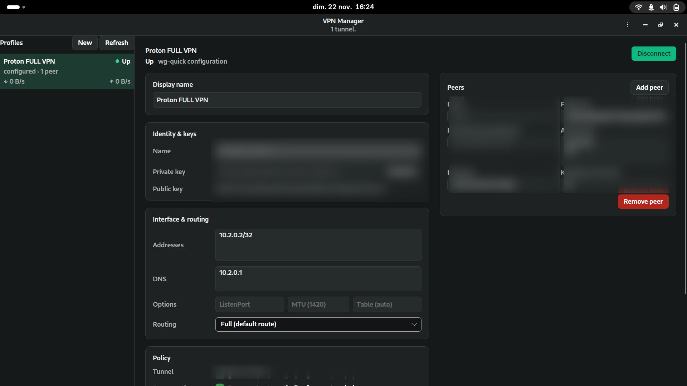
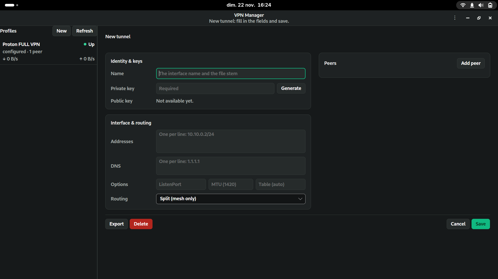
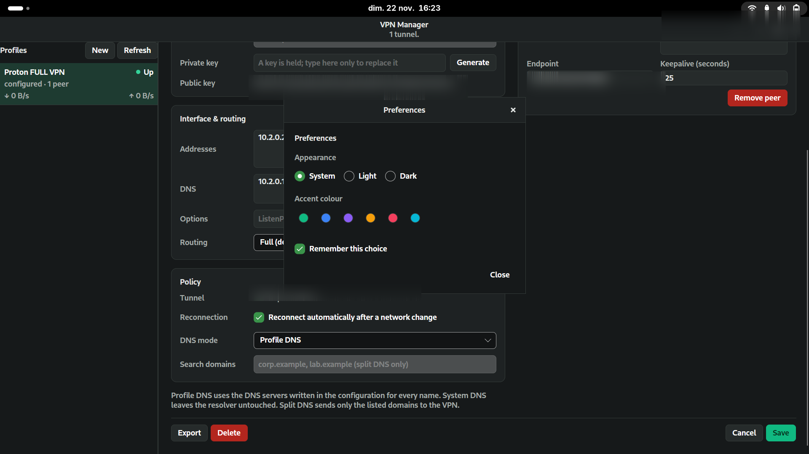
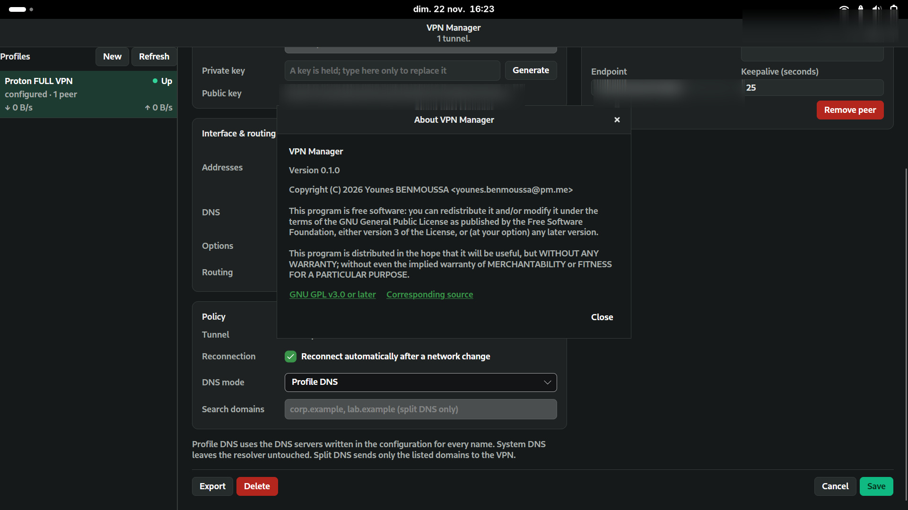

# VPN Manager

A per-user WireGuard client for Debian GNOME. It imports a profile, connects and
disconnects through NetworkManager, shows the live state of the tunnel, and never
prints a private key. The GUI never elevates; the one explicit `--fix-sysctl`
action goes through the fixed polkit helper.

- **Repository**: <https://github.com/benmoussa-younes/vpn-manager>
- **Licence**: `GPL-3.0-or-later` (see [`LICENSE`](LICENSE); the SPDX texts are in
  [`LICENSES/`](LICENSES))

## What it does

- Shows a persistent sidebar of the profiles under
  `~/.config/benmoussa/vpn-manager` (or the `--config-dir` value) and the
  WireGuard connections NetworkManager owns; selecting one opens its editable
  pane to the right. There is no separate detail page and no toolbar.
- Imports a `.conf` file, a pasted profile, or a full configuration text; exports
  a profile. A profile is written owner-only and parsed before it is stored.
- Connects and disconnects through `nmcli`, as the operator, one tunnel at a time.
- Shows each tunnel's state and live rate in the sidebar; the selected tunnel's
  pane holds its editable form. `--status` and `--diagnostics` report the policy,
  the IPv6 classification and the DNS containment.
- Connects and disconnects from the selected profile's pane. Network loss and
  the automatic reconnection are desktop notifications; a manual action shows a
  toast in the window.
- Keeps one instance per user and surfaces the running window on a second launch.
- Supports a `--read-only` session that browses and exports without changing
  anything.
- Applies a per-profile NetworkManager policy: automatic reconnection, and the
  `Profile`, `System` or `Split` DNS mode. The policy card in the
  pane edits those three settings and applies each change immediately; a live
  connection is updated without reconnecting.
- Saves the configuration with an explicit Save (the header shows a dot while
  the form has unsaved changes), while the display name commits inline and the
  policy applies on change.
- Uses the display name as the NetworkManager connection name (id), while the
  configuration file, the interface and the real tunnel name stay unchanged.
- Has no tray icon: closing the window quits, and asks before disconnecting a
  profile that is still up. A logout or shutdown closes without that dialog.
- Offers a headless CLI: `--status [--json]`, `--connect`, `--disconnect`,
  `--policy` and `--fix-sysctl`.
- Exposes the same operations on the user session bus as
  `com.bit-crafts.VpnManager` (interface `com.bit_crafts.VpnManager1`) for
  enterprise orchestration. The name is the reverse-DNS of the project's
  `bit-crafts.com` domain; the per-user paths stay under `benmoussa`.

## Screenshots

| Master-detail pane | New tunnel |
|---|---|
|  |  |

| Preferences | About |
|---|---|
|  |  |

The screenshots come from the 0.1.0 build; the endpoint, the public keys and the
machine name are blurred.

## What it is not

- Not a server, hub or peer-provisioning tool.
- Not a multi-protocol client: it manages WireGuard profiles only.
- Not a kill switch: it reports DNS containment, it never claims a leak is
  impossible.
- Not a general privilege tool: the GUI runs unprivileged and never invokes
  `sudo` or an arbitrary root command. One fixed full-tunnel sysctl action goes
  through the polkit-authorized helper; it never reads or writes
  `/etc/wireguard`.

## Command line

```
vpn-manager                      start the GUI
vpn-manager --config-dir <path>  manage a specific directory
vpn-manager --read-only          browse and export, change nothing
vpn-manager --diagnostics        report what is readable without a display
vpn-manager --status [--json]    print the profiles and their policy
vpn-manager --connect <profile>  bring a profile up through NetworkManager
vpn-manager --disconnect <profile>  take a profile down
vpn-manager --policy <profile> [--auto-reconnect on|off] \
  [--dns-mode profile|system|split] [--dns-search a,b|'']
vpn-manager --fix-sysctl       set the full-tunnel sysctl through polkit
vpn-manager --dbus             run the session D-Bus service
vpn-manager --self-test          run the display-free self-test
vpn-manager --version            print the version
vpn-manager --help               print the usage text
```

A manual `--disconnect` is authoritative: the profile is marked
`autoconnect no` until the next `--connect`, so NetworkManager does not bring it
back behind the operator's back.

## Policy

Each profile carries three settings beside its `.conf`, edited from the pane's
**Policy** card or from `--policy`:

| Setting | Effect |
|---|---|
| Reconnect automatically | `connection.autoconnect` in NetworkManager. A manual disconnect sets it to `no` until the next connect. |
| DNS mode | `Profile` sends every name to the `DNS =` servers of the configuration; `System` leaves the resolver alone; `Split` sends only the listed routing domains to the VPN (a leading `~` on each domain). Applied through `ipv4.dns`, `ipv4.dns-search`, `ipv4.dns-priority` and `ipv4.ignore-auto-dns`, never by editing `/etc/resolv.conf`. |
| Search domains | The routing domains for split DNS (`corp.example, lab.example`). An empty value clears them. |

The policy lives in `state.json` under the XDG state directory, not in the
`.conf`. The display name is the NetworkManager connection id: renaming a profile
renames the connection too, while the file stem, the interface and the tunnel
name stay the same.

## Requirements

- Debian 13 (trixie) amd64 with GNOME, on Wayland or X11.
- **NetworkManager** (`nmcli`) to connect and disconnect.
- **wireguard-tools** (`wg`) for key generation and runtime inspection.
- The GNOME notification daemon (`org.freedesktop.Notifications`) for the network
  notifications; it is part of a GNOME session.
- **systemd-resolved** (`resolvectl`) for the DNS containment report; the client
  still works without it.

## Install

The release publishes a Debian package, the matching source archive, an SPDX
document and the checksums of all three. Install the package as the operator:

```bash
sudo apt-get install -y ./vpn-manager_<version>-1_amd64.deb
vpn-manager
```

The package installs `/usr/lib/vpn-manager`, the `/usr/bin/vpn-manager` entry, the
desktop file and the icons. It also ships
`/usr/lib/sysctl.d/60-vpn-manager.conf`
(`net.ipv4.conf.all.src_valid_mark=1`), which a full tunnel through
NetworkManager needs on a stock Debian; the package applies only that file. The
GUI never elevates; `--fix-sysctl` is the one explicit helper action.

## Where the data lives

| Path | Contents |
|---|---|
| `~/.config/benmoussa/vpn-manager/` | The profiles the operator owns (owner-only, `0600`). |
| `~/.local/state/benmoussa/vpn-manager/` | State, appearance preferences, application log, operation journal and crash log. |
| `$XDG_RUNTIME_DIR/benmoussa-vpn-manager.socket` | The single-instance claim; the runtime directory is already per-user. |
| `$XDG_STATE_HOME/vpn-manager/run` | The run directory when `XDG_RUNTIME_DIR` is not set; it holds the same socket. |

A private key lives in the profile file (owner-only) and in memory while an
import or an export runs. It is never displayed, logged or passed as a
command-line argument.

### Coming from the previous WireGuard manager

The previous application stored its profiles in its own configuration
directory. Point the new client at that directory to keep managing them in
place:

```bash
vpn-manager --config-dir <the-previous-configuration-directory>
```

The display aliases and the other application state are not migrated; they live
in the previous state directory and are rebuilt as the client runs.

## Build from source

The product consumes **Core v0.2.3** as source: core is not a NuGet package, and
the tag is pinned in [`CORE_VERSION`](CORE_VERSION). Clone it beside this
repository:

```bash
git clone --branch v0.2.3 --depth 1 https://github.com/benmoussa-younes/core.git ../core
git -C ../core describe --tags --exact-match   # prints v0.2.3 for this clone
```

A sibling checkout that follows `core`'s `main` is accepted when the pin is in
its history and `core/src` plus the root build files the gate pins are identical
to the pin and clean.

Then build, test and run the gate:

```bash
export DOTNET_SYSTEM_GLOBALIZATION_INVARIANT=1   # Debian ships no ICU

dotnet restore VpnManager.slnx
dotnet build   VpnManager.slnx -c Release
dotnet test    VpnManager.slnx -c Release --no-build

./tools/scripts/binaries/gate.scs                # one VERDICT line, exit 0/1
```

The gate needs the Scripts interpreter on `PATH` (`scripts --version`), Git and
`reuse` (`reuse lint`). The `.scs` syntax check is a CI step, not a verdict:

```bash
scripts check tools/scripts/binaries/gate.scs
```

Publish the only shipping form, Native AOT. It needs a C toolchain and the
zlib/fontconfig headers (`sudo apt-get install clang zlib1g-dev libfontconfig1`):

```bash
dotnet publish src/VpnManager.App/VpnManager.App.csproj \
  -c Release -r linux-x64 -o publish
./publish/vpn-manager --self-test
```

Count the `ILC: ` lines of the publish: zero is the proof. `--self-test` runs
the display-free claims on the published native binary; `dotnet test` runs the
Xunit v3 suite in JIT.

## Coverage

```bash
dotnet test VpnManager.slnx -c Release \
  --collect:"XPlat Code Coverage" --results-directory artifacts/coverage
```

The report covers the hand-written `VpnManager.Core`, `VpnManager.App` and
`VpnManager.Helper` assemblies. Core is above 95 % line coverage; the Avalonia
shell is the residual.

## Package the Debian package

```bash
packaging/build-deb.sh
```

It stages the Native AOT publish, the desktop entry, the icons, the manual page
and the sysctl drop-in, then builds `artifacts/vpn-manager_<version>-1_amd64.deb`.

## Security model

- No secret is ever printed: a private key is never displayed, logged or passed
  as a command-line argument.
- No general elevation: the GUI runs as the operator. The only privileged path
  is the fixed `--fix-sysctl` action, launched by `pkexec` and authorized by the
  polkit action `com.bit-crafts.vpn-manager.sysctl-src-valid-mark`; the helper
  accepts one verb and no caller path or command.
- No system write to `/etc/wireguard`. The package installs the sysctl drop-in;
  the explicit `--fix-sysctl` action sets and verifies that one sysctl.
- Every external command is an argument vector, never a shell string; a bare
  tool name resolves against fixed system directories, never `PATH`.
- Profiles are read with a bounded, no-follow read and written atomically
  owner-only. A stored profile is re-validated before it is handed to
  NetworkManager; a `PreUp`/`PostUp`/`PreDown`/`PostDown` hook is stripped from
  the imported copy because NetworkManager does not execute it, while the stored
  profile keeps the original lines.
- DNS containment is reported as `Contained`/`Split`/`Uncontained`/`Unknown`;
  no leak is claimed impossible. The DNS mode is applied through NetworkManager
  (`ipv4.dns`, `ipv6.dns`, `dns-search`, `dns-priority`,
  `ignore-auto-dns`), never by editing `/etc/resolv.conf`. A policy change on an
  active connection is reapplied with `nmcli device reapply`, so it holds at
  once; `--dns-search ""` clears the stored search domains.
- A user-scope session configures a profile but cannot bring it up without the
  NetworkManager policy that every GNOME session already has; the interface says
  so instead of failing silently.

See [`SECURITY.md`](SECURITY.md) for the private vulnerability report.

## Contributing and warranty

External contributions are **not accepted**: unsolicited pull requests or
patches may be closed without review. A fork is the supported way to build on
this work; the licence below lets you use, study, change and redistribute your
fork. The project is maintained by one author: no support contract, service
level or warranty, express or implied, is provided beyond the licence. The
vulnerability channel in [`SECURITY.md`](SECURITY.md) is read on a best-effort
basis, with no promised delay or fix.

## Licence

`GPL-3.0-or-later`. Copyright (C) 2026 Younes BENMOUSSA
<younes.benmoussa@pm.me>. [`LICENSE`](LICENSE) carries the GNU GPL version 3
text, the one a code host reads at the repository root; the gate compares it with
[`LICENSES/GPL-3.0-or-later.txt`](LICENSES/GPL-3.0-or-later.txt), the SPDX text
the REUSE metadata names. The documentation is `CC-BY-SA-4.0`; the third-party
components are listed in [`THIRD-PARTY`](THIRD-PARTY).
